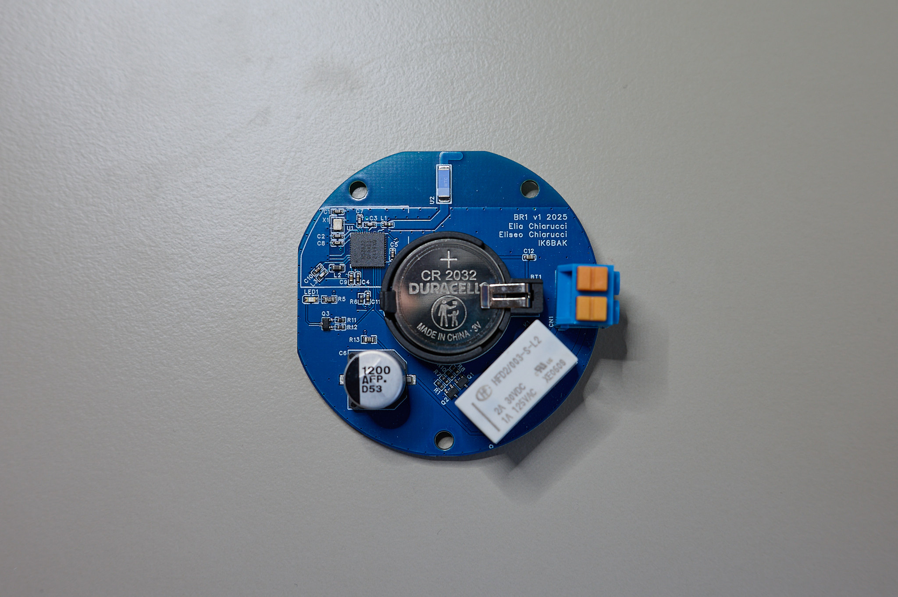
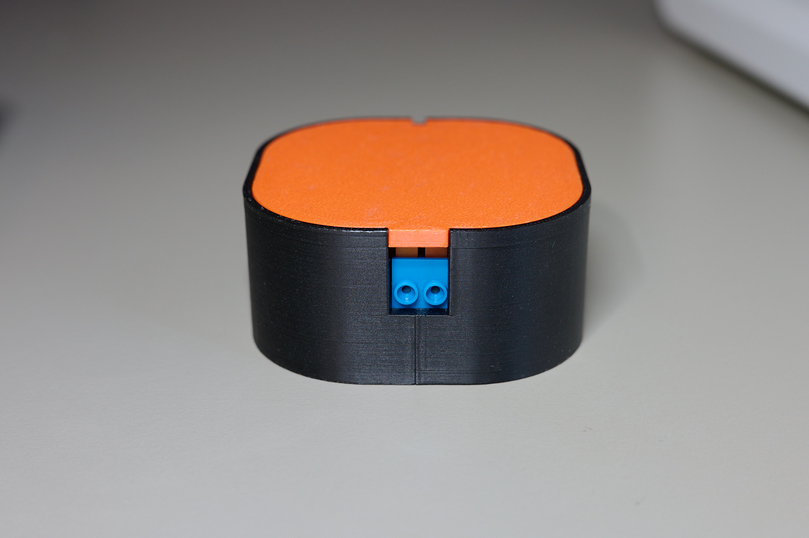
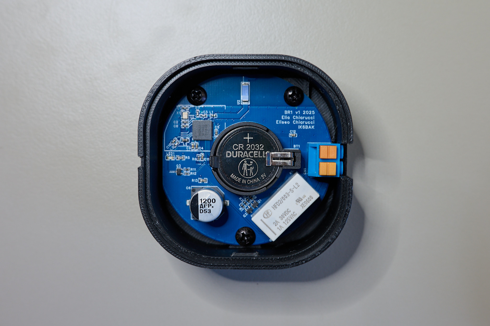

# Firmware for EFHW switch

This repository contains the firmware for the [EFHW switch](https://www.morsekey.net/efhw-switch).





The board runs on a Nordic nRF52832 microcontroller, and is powered by a CR2032 coin cell battery.

This project was created using NRF Connect SDK version 2.9.0

## Building from the command line

Requires the nRF Connect SDK v2.9.0 and its toolchain (e.g. installed through nRF Connect for VS Code) and [nrfutil](https://www.nordicsemi.com/Products/Development-tools/nRF-Util). From the repository root:

```bash
nrfutil install sdk-manager     # once
nrfutil sdk-manager toolchain launch --ncs-version v2.9.0 -- \
  bash -c 'ZEPHYR_BASE=/opt/nordic/ncs/v2.9.0/zephyr west build -p always -b BLE_Relay/nrf52832 --sysbuild -d build -- -DBOARD_ROOT=$PWD'
```

This produces `build/merged.hex` (MCUboot + application).

`/opt/nordic/ncs` is the default SDK location on macOS; adjust `ZEPHYR_BASE` if yours differs (default `~/ncs` on Linux, `C:\ncs` on Windows, where the command needs Git Bash or WSL for `bash -c`).

A latching relay is used to prolong battery life up to 12 months, depending on usage.

Flashing and debugging is usually done from another Nordic devboard using the official NRF Connect extension and the Segger RTT terminal program.
There are also instructions for using an FTDI board and/or OpenOCD in the FTDI folder.